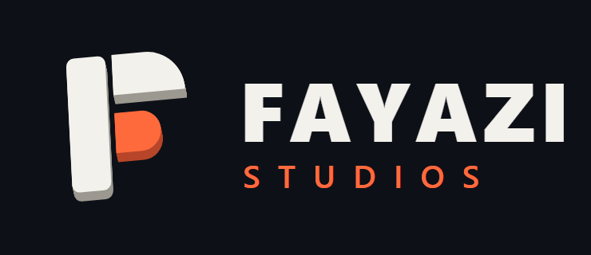

  

  <b>AI-first studio building intelligent software, games, simulators and smart hardware.</b>

  
  
  

---

### What we build

| | |
|---|---|
| 🤖 **AI agents & automation** | LLM-powered assistants, AI agents, fine-tuned models and workflows that automate repetitive work. |
| 👁️ **Computer vision** | Object detection, image analysis and real-time camera solutions with OpenCV and modern vision models. |
| 🎮 **Games & VR/AR** | Polished mobile and PC games and immersive VR/AR experiences, built and QA-tested by game developers. |
| 🏎️ **Simulators** | Software and hardware for racing sims, physical simulators and training simulations. |
| 📡 **Hardware & IoT** | Custom hardware integrated with software, and smart devices you control from a mobile app. |
| 🧰 **Apps & tools** | Mobile apps and PC productivity tools that solve real, everyday problems. |

### How we work

1. **Tell us your idea.** We'll understand the problem and suggest the right solution.
2. **We prototype fast.** AI-assisted development gets you a working version early.
3. **Test, polish, launch.** Our QA background means every product is tested before it reaches users.

### Tech we use

  
  
  
  
  
  
  
  

---

Founded by <a href="https://github.com/Sulman-Ahmad">Sulman Ahmad</a> · <a href="https://fayazistudios.com">fayazistudios.com</a>

